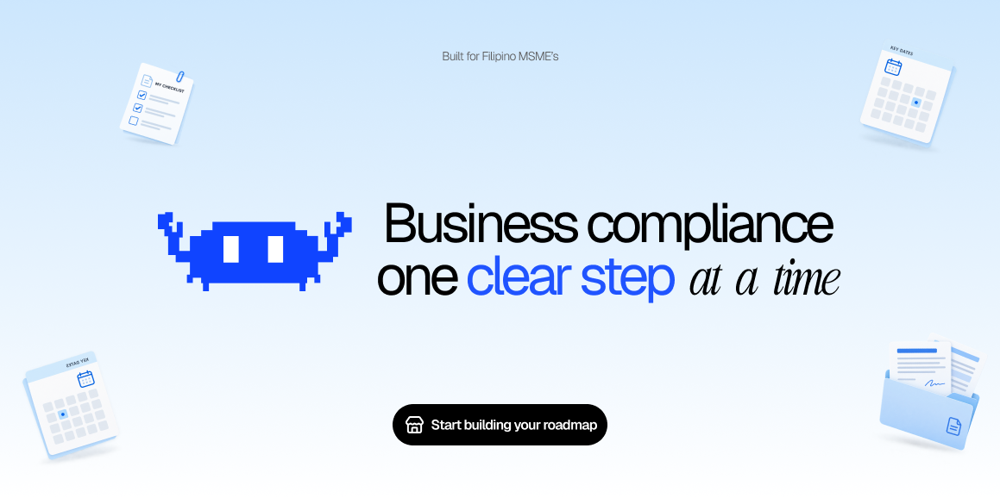

# [HERMIT](https://hermit-eight.vercel.app/)



### Your business, remembered. Your next step, explained.

**One calm place to navigate the paperwork of running a business in the Philippines.**

An MSME owner should not have to become an expert in government acronyms just to open a shop, renew a permit, or understand a tax form. Hermit turns a maze of requirements, offices, portals, documents, and dates into a guided journey that starts with a simple question: **What kind of business are you building?**

> **The pitch:** Tell Hermit about your business once. Get a roadmap for what may apply, why it matters, what to prepare, and where to go next. Ask Kuya Hermit when something is confusing. Keep your forms, documents, deadlines, and progress together. Move from *“Saan ako magsisimula?”* to *“Alam ko na ang next step.”*

**Built for Philippine micro, small, and medium enterprises. Powered by eGov. Designed for the owner who has a business to run.**

## The problem we're solving

For many owners, compliance feels like a second full-time job. The answer to “What do I need?” depends on the business, its activities, its location, and whether it is opening, operating, hiring, renewing, or closing. The answer may be scattered across agency websites, forms, counters, and advice from other people. A missed prerequisite sends an owner back to the start; an unexplained form can stop them before they begin.

Hermit makes that process less intimidating. It gives the owner a place to understand the work, prepare for it, and remember what has already been done. No fixer. No mystery checklist. No expectation that every owner already speaks the language of bureaucracy.

## A journey an owner can actually follow

**Imagine a small food business in the City of Manila.** Its owner tells Hermit what they sell, how they operate, and whether they have employees. Hermit builds a relevant roadmap instead of handing over a generic list. Each step explains the reason it appears, what comes before it, which office or official portal handles it, and what the owner should prepare.

When a form asks for details the owner has already provided, Hermit can help fill them in for review. When a permit arrives, the owner can keep a copy and its important dates in the vault. When a term is unfamiliar, Kuya Hermit explains it in plain language and points back to the available sources. The dashboard remembers the next action so the owner does not have to reconstruct the whole process on every visit.

**Describe your business → understand your roadmap → prepare forms and documents → use the relevant government service or official channel → track what happens next.**

### What Hermit brings together

| The owner's question | Hermit's answer |
| --- | --- |
| “Where do I start?” | Guided onboarding and a business-specific roadmap with prerequisites and progress tracking. |
| “What does this requirement mean?” | Kuya Hermit explains the task using Hermit's available requirement and form information, with source links where available. |
| “Didn't I already give you this information?” | Editable form sheets and supported official PDFs can start with known details; the owner reviews every answer. Reusing saved form answers requires an explicit opt-in. |
| “Which form do I need, and where do I get it?” | A library of **404 business-related government forms** from 11 agencies, plus a guided catalog of 46 forms where **31 fill themselves** onto the official PDF for the owner to review, sign, and download. |
| “Where did I put that permit?” | A document vault, review checks, important dates, and packet preparation keep the work organized. |
| “When is this due, and where do I go?” | A calendar, deadline views, official starting points, and an office locator help the owner plan the next step. |
| “How do I pay or report a problem?” | eGovPay can power a payment flow in test mode; eReport is wired for reporting red tape when configured. |

## Every form, in one place

Hermit keeps copies of the government forms a business actually runs into, so the owner never has to hunt across agency websites for the right PDF.

* **404 business-related forms** in Hermit's forms library, searchable by name or agency, each one a click away as a PDF. Most (363) include their text, so Kuya Hermit can find a form, explain what it asks for, and attach it to its answer.
* **46 forms in the guided catalog**, tied to the roadmap. Official copies are stored for 33 of them, and **31 fill themselves**: Hermit places the owner's details on the real form, ready to review, sign, and download from the chat or the form editor.

| Agency | Forms in the library |
| --- | ---: |
| FDA | 82 |
| BIR | 81 |
| SSS | 54 |
| CDA | 51 |
| SEC | 49 |
| Pag-IBIG Fund | 23 |
| DOLE (incl. BWC and BLE) | 19 |
| DTI | 16 |
| PhilHealth | 12 |
| IPOPHL | 9 |
| Bureau of Customs | 8 |
| **Total** | **404** |

Forms are copied from agency websites and from the public aggregator [formsphilippines.com](https://formsphilippines.com/). They are blank official forms for reference and preparation; owners should confirm they are using the agency's current version before filing.

## Powered by eGov, connected to the bigger picture

Hermit uses [egov.js](https://github.com/omsimos/egov.js) as its bridge to Philippine eGov platform services. The goal is a connected experience: identity, verification, communication, payment, and reporting alongside a roadmap that points owners to the appropriate agency. Each service has its own integration, so it can run with configured credentials or use a clearly separate mock during development.

| eGov service | How Hermit uses it |
| --- | --- |
| **eGovPH SSO** | Sign in with an eGovPH identity and return to the owner's saved workspace. |
| **National ID eVerify + face liveness** | Offer a separate identity check and help fill verified personal details. Sign-in alone is not presented as National ID verification. |
| **eGovPay** | Open a government payment checkout and check the transaction status. The current integration uses a **test-mode token**. |
| **eMessage** | Support SMS reminders when the service is configured. |
| **eGov AI** | Support classification, explanations, and document reading, with local fallbacks for development. |
| **eReport** | Give owners a way to report red tape when connected. |

Hermit also points owners toward official channels for agencies such as **DTI, BIR, SEC, CDA, local government offices, and employer agencies**, according to the task at hand. It helps prepare and review forms before that handoff. **Direct application or tax-return submission to those agencies is not connected yet**: the in-app filing and tracking experience is a labelled demo, and owners must still file through the agency's official channel. eGov integration does not imply endorsement by, or live submission access to, every agency.

## What makes this more than another checklist

* **It starts with the owner, not an agency menu.** Business activities, structure, location, and stage shape the suggested path.
* **It makes the next action visible.** Requirements, dependencies, documents, forms, dates, and offices live in one workspace.
* **It remembers with consent.** The owner can review and edit form values; optional answer reuse is off by default.
* **It explains without pretending to decide.** Kuya Hermit helps with language and preparation. The owner remains in control of legal, tax, and filing decisions.
* **It is built for real government touchpoints.** eGov services and official agency handoffs are part of the flow, with mock and test states made visible.

## See it in action

```bash
pnpm install
pnpm dev

```

Either open the link https://hermit-eight.vercel.app/ or Install the repo Open [http://localhost:3000](http://localhost:3000). You can explore the landing page and try the [local onboarding flow](http://localhost:3000/onboarding) without service credentials. Account sign-up, sync, payments, maps, and eGov services require their respective configuration: copy [`.env.example`](.env.example) to `.env.local` and add the credentials you have access to. Without Supabase, owner data uses device storage and server-backed features are unavailable. 

For a populated showcase, open [`/demo`](http://localhost:3000/demo) **after configuring Supabase and its migrations**. This resets a shared fictional Taguig business on every visit; it is a legacy sample, while new onboarding is Manila-only. Its documents, payments, and filings are sample data, not government records or real transactions.

**Suggested judge tour:** try a demo business  → onboarding → roadmap → Kuya Hermit → forms and document vault → payment and filing hub → eGov integration status in Profile.

## Built today, building toward tomorrow

The current prototype focuses new onboarding on the **City of Manila**. It includes a working product journey and adapter-backed eGov flows, but government access depends on credentials and the specific service. eGovPay is in test mode. Agency filing and its progress timeline are demos. Requirements, fees, and dates in the seed library still need review against current official sources and the relevant Manila offices before they can be treated as authoritative guidance.

The next milestone is a validated Manila pilot: review each requirement with official sources, test the live integrations, connect actual agency submission/status channels where access is available, and expand coverage only when the guidance can be supported. Hermit is a guide and workspace for owners, not a government agency or a guarantee that a business is compliant.

## For builders

Hermit is a Next.js and TypeScript app with a Supabase-backed option for accounts and data, a device working copy, an `egov.js` integration layer, and an AI assistant that uses Hermit's own business context. The project keeps mock services available for local development.

```bash
pnpm test
pnpm typecheck
pnpm lint
pnpm build

```

Read the [current implementation inventory](docs/IMPLEMENTATION.md), [target MVP](docs/PRD.md), [scope and known gaps](docs/SCOPE.md), and [source and review policy](docs/SOURCES.md) for the detailed contract behind this pitch.

---

**Less paperwork panic. More time to build the business.**
