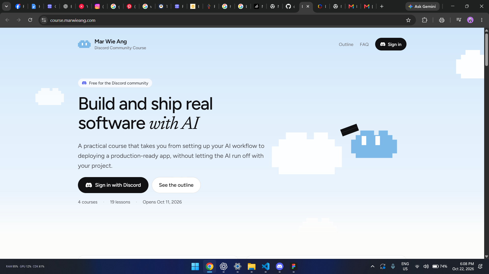

# Hermit — Design philosophy

Status: approved target direction. The current green/Taglish interface remains unchanged by this documentation checkpoint.

## Purpose

Hermit should feel calm, clear and approachable. Owners should understand the next action without having to study a dense dashboard. Use the supplied reference's light-blue atmosphere, strong dark text, generous spacing and restrained rounded controls.

The reference informs color and visual balance. Its course branding, Discord controls, mascot and artwork are not Hermit assets. No mascot, pixel-art system or decorative animation was approved.

## Palette and roles

These are chosen design values inspired by the screenshot, not a claim of exact sampled colors.

| Token | Value | Intended role |
| --- | --- | --- |
| Sky | `#D8EBFC` | Introductory background and broad calm surfaces. |
| Canvas | `#F6FAFE` | Main page background. |
| Surface | `#FFFFFF` | Forms, task details and other working surfaces. |
| Blue accent | `#7FB7E4` | Selection fills, accents and restrained illustration details. |
| Ink | `#111827` | Headings, important text and primary button backgrounds. |
| Secondary text | `#52606D` | Supporting explanations and metadata. |

Use white text on ink primary buttons. Pale blue is mainly a surface/accent color; do not assume white labels on light blue have sufficient contrast. Check each actual text, border, focus and status combination during implementation. Semantic success, warning and error indicators may use suitable colors, but must also include text or an icon. Never make color the only explanation of a status.

Start with the approved light appearance. A dark-mode redesign or new theme-switching requirement is not part of this checkpoint. Preserve existing theme functionality until separately revised.

## Typography and spacing

Use a system sans-serif stack such as `system-ui, -apple-system, BlinkMacSystemFont, "Segoe UI", sans-serif`. It should remain available offline without fetching a font. Use the same family for headings and instructions, with weight and size establishing hierarchy.

- Body text starts at 16px with approximately 1.5 line height.
- Use short, sentence-case headings and readable line lengths.
- Use 16–24px mobile page padding and consistent spacing increments.
- Aim for at least 44px touch targets for primary controls.
- Use restrained 12–16px rounding on working cards/controls; avoid ornamental shadows and nested decorative panels.

Implementation should map these roles into existing Tailwind/shadcn tokens. A new design system package is unnecessary.

## Information hierarchy and navigation

The selected business and its **next action** should be obvious. Put the next action ahead of supporting counts. Keep blocked tasks, submitted tasks and upcoming confirmed dates easy to find without making everything equally prominent.

Use a desktop sidebar and a compact mobile navigation pattern. Include business switching and active-page labels. Office Locator remains a navigation destination with an empty page; functional maps, lists and reports are not part of its approved target.

Use one column for mobile working flows. Desktop may place secondary explanations beside the main task, while preserving reading order. Long preparation lists and supporting details can expand on demand, but sources and coverage notices must remain easy to discover.

Keep these distinctions visible:

- Submitted versus completed.
- Recorded progress versus prerequisite readiness.
- Document expiry versus filing deadline versus preparation date.
- Officially reviewed dates versus owner-confirmed dates.
- Tracked-task completion versus overall legal compliance.
- Online saved data versus an offline snapshot.

## Interaction and writing

Use English throughout the interface, guidance and assistant replies. Explain agency acronyms and unfamiliar terms close to where they appear. Use calm, nonjudgmental wording, including for businesses already operating or closing.

Controls describe their result: “Save changes,” “Mark completed,” “Export calendar,” and “Send question.” Unknown choices say “I'm not sure.” Errors identify what failed and the next available action; do not show a successful save when storage failed.

Keep the main action for the current step visually dominant. Preserve entered values when a recoverable request fails. Use visible keyboard focus, associated form labels, logical reading order and status announcements where needed. Respect reduced-motion preferences; short functional transitions are sufficient.

AI chat uses source links and review dates as part of the answer. Its microphone control shows recording and transcription states; generated text remains editable and unsent until the owner chooses Send. Do not use a microphone control elsewhere in the target MVP.

## Design acceptance

Review the complete owner journey at a narrow mobile width and with keyboard navigation. Check that the owner can identify the selected business, next action, prerequisite, date origin and source without relying on color or hover. Compare overall palette and spacing with the reference while using Hermit's own content and identity.
